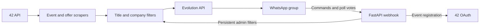

<div align="center">

# WhatsApp Bot for 42

### Campus events and career opportunities, straight to your WhatsApp group.

**Catch the events that matter. Filter the noise. Register without leaving the conversation.**

[](pyproject.toml)
[](src/whatsapp_bot/main.py)
[](docker-compose.yml)
[](uv.lock)
[](#development)

[Quick start](#quick-start) · [How it works](#how-it-works) · [Features](#features) · [Commands](#commands) · [FAQ](#faq) · [Documentation](#documentation)

<code>uv sync --frozen</code>

<br />

**42 Intra → Your filters → WhatsApp**

Events · Job offers · Company matching · OAuth registration

</div>

---

Keep your campus group informed without checking Intra all day. This bot watches the 42 API for new events and job offers, applies your filters, and posts matching updates to WhatsApp through Evolution API.

Students can browse upcoming events, look up offers, and link their 42 account to register for events. Administrators can exclude event titles or companies directly from WhatsApp. Optional Gemini summaries condense longer event descriptions for polls.

> [!IMPORTANT]
> This is a self-hosted community project, not an official 42 or WhatsApp service. Use an account you are authorized to connect and follow the platforms' terms. Keep API keys, linking QR codes and user tokens private.

## Quick start

### 1. Prepare your environment

You need **Python 3.11+**, [uv](https://docs.astral.sh/uv/), Docker with Compose, a WhatsApp account, and a 42 OAuth application.

From the repository root:

```bash
cp .env.example .env
cp evolution.env.example evolution.env
chmod 600 .env evolution.env
uv sync --frozen
```

Configure the two environment files before starting:

| File | What belongs here |
| --- | --- |
| [`.env`](.env.example) | Bot API key, 42 credentials, webhook secret, token encryption key and destination group |
| [`evolution.env`](evolution.env.example) | Evolution API key, PostgreSQL and Redis credentials, connection URIs and webhook destination |

`BOT_EVOLUTION_API_KEY` must match `AUTHENTICATION_API_KEY`. Set strong, independent database and Redis passwords and check their connection URIs. Generate the webhook secret and Fernet key using the commands in [`.env.example`](.env.example). Configure the 42 application's callback URL to match `BOT_FT_REDIRECT_URI` exactly.

### 2. Start Evolution and link WhatsApp

```bash
docker compose --env-file evolution.env up -d
uv run python scripts/create_instance.py
```

Scan the instance QR code from **WhatsApp → Settings → Linked devices → Link a device**.

Evolution is exposed on **`127.0.0.1:18080`**. The bot defaults to port **8000**; the production example uses **8090**. Set the bot bind address, `WEBHOOK_GLOBAL_URL` and host firewall so the Evolution container can reach the bot. Do not expose an unauthenticated webhook.

> [!NOTE]
> The environment templates include production-oriented webhook settings. Match the webhook port to your bot's actual port before running locally.

### 3. Choose your group and run the bot

```bash
uv run python scripts/list_groups.py
```

Set `BOT_WHATSAPP_GROUP_JID` to the destination group. Enable the background feeds you want:

```dotenv
BOT_SCRAPER_ENABLED=true
BOT_OFFERS_SCRAPER_ENABLED=true
```

Then start the bot:

```bash
uv run bot
```

Keep `data/` between runs. It stores deduplication state, event mappings and user credentials. Configure `BOT_TOKEN_ENCRYPTION_KEY` to encrypt stored OAuth tokens.

## How it works



The bot polls for new content, filters it before publication, and keeps track of processed IDs so the same items are not posted every cycle. Incoming WhatsApp messages and poll votes reach the bot through an authenticated webhook.

Company matching can trigger additional Tier 1 notifications. Event-title Tier 1 matches can also auto-register linked users when the required OAuth components are configured. Review [`config/tier1_companies.txt`](config/tier1_companies.txt) before enabling that workflow. Job offers are informational and never auto-register users.

**Job offers use semantic hiring-employer extraction**, not title or description keyword matches. Gemini reads numbered passages from the offer and returns the hiring company, its employment relationship and source-passage IDs. Code retrieves those passages verbatim, validates the response and performs an exact lookup against the Tier 1 roster and [reviewed employer aliases](config/employer_aliases.toml). It does not infer hiring relationships using regexes or let the model decide Tier 1. Tool vendors, partners, accelerators and former employers are not the hiring company. Recruitment agencies hiring for clients are distinguished from consultancies employing their own staff.

Polling and `/offers` share a persistent cache, keyed by visible source text, offer ID, model, prompt and schema. Identified employers expire after seven days; unknowns after one hour. Model requests are serialized and paced. Unknown or unnamed employers never trigger Tier 1 alerts. Provider or validation failures leave background offers unseen for a later retry; on-demand replies explicitly show extraction unavailable. Without a Gemini key, offers still post with an unverified employer and no Tier 1 offer alert. Existing seen IDs are preserved, so this does not replay old offers.

**Events retain their separate matching policy.** Event description matches require local organization context, such as a speaker, organizer or partner, rather than employer identity. Canonical company names in event titles remain eligible with tool/topic guards; event-description matches notify only and do not auto-register. This event matching is conservative and deterministic, and can miss unsupported phrasings.

Employer extraction is probabilistic. Source citations establish provenance, not the correctness of a hiring relationship. The agent-reviewed development evaluation is documented in [the work ledger](reports/recovery.md), with its remaining uncertainty; it is not a general accuracy guarantee.

## Features

| Capability | What it does |
| --- | --- |
| **Campus events** | Publishes new events with dates, locations and registration polls |
| **Career opportunities** | Posts job and internship offers with student-facing Intra links |
| **On-demand browsing** | Answers `/events` and `/offers`, with kind, contract and keyword options |
| **Event exclusions** | Blocks unwanted event-title keywords through admin commands |
| **Company exclusions** | Blocks company mentions across events and offers |
| **Tier 1 matching** | Uses resolved hiring employers for offer alerts; separate organization matching for events |
| **42 account linking** | Uses OAuth for event registration and cancellation |
| **Optional summaries** | Uses Gemini to condense event descriptions for WhatsApp polls |
| **Persistent state** | Preserves processed items, event mappings and user tokens across restarts |

## Commands

### Browse and register

```text
/events
/events workshop search AI
/events available

/offers
/offers stage search python
/offers help
```

Use `/events help` or `/offers help` for the full query syntax. Vote **Register** or **Unregister** on an event poll to manage attendance. If your account is not linked, the bot sends a 42 authorization link.

Offer links use the numeric API ID: `https://companies.intra.42.fr/en/offers/<id>`. You may need to sign in with your student account.

### Filter the noise

Set `BOT_ADMIN_WHATSAPP_NUMBER` to your international phone number, digits only. Filter commands work in a direct chat or group, with confirmations sent privately to the administrator. Other senders cannot manage or list filters.

| Action | Event titles | Companies |
| --- | --- | --- |
| **Exclude** | `/filter Afterwork` or `/f Afterwork` | `/filtercompany Acme` or `/fc Acme` |
| **Remove exclusion** | `/unfilter Afterwork` or `/uf Afterwork` | `/unfiltercompany Acme` or `/ufc Acme` |
| **List exclusions** | `/filters` or `/fs` | `/filterscompany` or `/fcs` |

Commands are case-insensitive. Company names can contain spaces and optional surrounding double quotes, up to 80 characters.

<details>
<summary><strong>How do company exclusions match?</strong></summary>

The shared blocklist is saved in `[companies].exclude_names` in [`config/filters.toml`](config/filters.toml). It matches normalized whole phrases in event names and descriptions, offer titles and descriptions, and the explicit company name when available.

Matching ignores case and accents, and normalizes punctuation. `Meta` matches `Meta engineers`, but not `metadata`. Names are literal phrases, not regular expressions. Brand aliases are not inferred; add distinct names separately. This filters mentions, not verified employer identity.

Company exclusions apply to background feeds and on-demand `/events` and `/offers` queries, before Tier 1 registration or notification side effects.

</details>

<details>
<summary><strong>When do filter changes take effect?</strong></summary>

Both background scrapers reload configuration at the start of each cycle. On-demand queries load company exclusions on the next request. No restart is needed.

Changes do not cancel a cycle already in progress, retract messages or undo registrations. Rejected items are marked as seen. Removing an exclusion does not replay previously rejected items.

</details>

## Configuration

Start with the environment templates and configuration files:

| Setting | Purpose |
| --- | --- |
| `BOT_FT_CLIENT_ID`, `BOT_FT_CLIENT_SECRET` | Authenticate requests to the 42 API |
| `BOT_FT_REDIRECT_URI` | Public callback for linking student accounts |
| `BOT_WHATSAPP_GROUP_JID` | Select the destination WhatsApp group |
| `BOT_ADMIN_WHATSAPP_NUMBER` | Restrict filter administration |
| `BOT_WEBHOOK_SECRET` | Authenticate Evolution webhook deliveries |
| `BOT_TOKEN_ENCRYPTION_KEY` | Encrypt stored user OAuth tokens |
| `BOT_GEMINI_API_KEY` | Enable semantic offer-employer extraction and optional event summaries |
| `BOT_EMPLOYER_MODEL` | Extractor model ID (default `gemini-3.5-flash-lite`) |
| `BOT_EMPLOYER_CACHE_PATH` | Shared persistent employer cache (default `data/employers.json`) |
| [`config/filters.toml`](config/filters.toml) | Event, offer and shared company exclusions |
| [`config/tier1_companies.txt`](config/tier1_companies.txt) | Company names used for Tier 1 detection |
| [`config/employer_aliases.toml`](config/employer_aliases.toml) | Exact reviewed employer identities mapped to roster names |

See [`.env.example`](.env.example) and [`evolution.env.example`](evolution.env.example) for polling intervals, storage paths and other settings.

## FAQ

<details>
<summary><strong>Do I need Gemini?</strong></summary>

Not for basic feeds, browsing or event registration. Event summaries are optional and otherwise use standard formatting and truncation. Semantic employer identification and Tier 1 **offer** alerts require a Gemini key. Without one, offers explicitly show an unverified hiring company; there is no keyword fallback.

</details>

<details>
<summary><strong>The health endpoint is green. Why is nothing arriving?</strong></summary>

`GET /health` reports process liveness only. It does not verify 42 credentials, scraper success or WhatsApp connectivity.

Check the service logs, confirm the Evolution instance reports `open`, verify 42 authentication, and confirm the destination group and scraper settings. See the [operations guide](deploy/README.md).

</details>

<details>
<summary><strong>What should I back up?</strong></summary>

Back up `data/`, both private environment files, the token encryption key, and the PostgreSQL and Evolution session volumes securely. Losing the encryption key makes encrypted OAuth tokens unreadable. Never put backups, QR codes or session data in Git.

</details>

<details>
<summary><strong>Can I use the deployment script on an existing server?</strong></summary>

Review it first. Provisioning installs packages, changes nginx and firewall configuration, and restarts services. The current installer also generates a self-signed origin certificate; that is not sufficient for Cloudflare Full (strict).

Do not rerun provisioning just to rotate credentials. Follow the [deployment notes](deploy/README.md), preserve existing certificates and review the [known limitations](BACKBURNER.md).

</details>

## Development

Install the test dependencies and run the suite:

```bash
uv sync --frozen --extra dev
uv run --frozen --extra dev pytest -v
```

Tests use mocked external services. They do not establish live WhatsApp delivery or successful browser OAuth registration. Verify those workflows separately with an authorized account.

For changes, include focused regressions and keep secrets out of fixtures. Preserve compatibility and persistent state when modifying message handling or scraper behavior.

## Documentation

- [Deployment and operations](deploy/README.md): service setup, credentials, reconnection and backups.
- [Bot environment](.env.example): application configuration and secret-generation commands.
- [Evolution environment](evolution.env.example): container dependencies and webhook settings.
- [Filter configuration](config/filters.toml): event and offer filtering rules.
- [Recovery and verification](reports/recovery.md): incident findings, local changes and evidence.
- [Known limitations](BACKBURNER.md): deferred monitoring and provisioning work.

## Publishing safely

The repository excludes environment secrets, private keys, certificates, QR images, runtime data, logs and local agent state. `uv.lock` is versioned for reproducible installs.

Before uploading to GitHub, inspect the actual files and staged diff:

```bash
git status --short --untracked-files=all
git diff --cached
```

Never upload an entire VPS directory or database backup. Review organization-specific configuration and choose a license before publication.

## License

No project license has been selected yet. Do not assume an open-source license applies until a license file is added.
